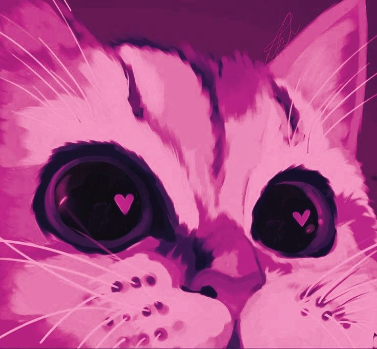

<div align="center">

# 🖥️ MOCHA & MODULES

### THREE TERMINALS. THREE PERSONALITIES. ONE MAKEOVER.

`KITTY` · `FASTFETCH` · `CUSTOM CONFIGURATIONS`

A collaborative terminal customisation project exploring the art of making your terminal feel a little more like you.

[Explore the setups](#-the-setups) · [Installation](#-getting-started) · [Contributors](#-the-people-behind-the-pixels)

---

**DEFAULT SETTINGS ARE SO LAST SEASON.**

</div>

## ✳ ABOUT THE PROJECT

The terminal doesn't have to be boring.

Mocha & Modules started with a simple idea: take the ordinary terminal and give it a little personality.

Three people, three different aesthetics, and plenty of experimenting with colours, fonts, wallpapers and configurations.

Using **Kitty** and **Fastfetch**, we created three individual setups, each with its own visual identity.

Whether you're here for inspiration or looking to give your own terminal a makeover, feel free to explore, experiment and make these configurations your own.

---

## ✿ THE SETUPS

Three different takes on terminal customisation.

### 01 / IMAAN

*A personal corner of the terminal universe.*

<!-- Replace with your preferred screenshot -->
<p align="center">
  
</p>

**Configuration files**

- [Kitty configuration](imaan/kitty.conf)
- [Fastfetch configuration](imaan/fastfetch.jsonc)
- [Screenshots and wallpapers](imaan/screenshots/)

[Explore Imaan's setup →](imaan/)

---

### 02 / SAYYEDA

*A different personality, a different terminal.*

<p align="center">
  
</p>

**Configuration files**

- [Kitty configuration](sayyeda/kitty.conf)
- [Fastfetch configuration](sayyeda/fastfetch.jsonc)
- [Screenshots and wallpapers](sayyeda/screenshots/)

[Explore Sayyeda's setup →](sayyeda/)

---

### 03 / RIJA

*Another setup, another world.*

<p align="center">
  
</p>

**Configuration files**

- [Kitty configuration](rija/kitty.conf)
- [Fastfetch configuration](rija/fastfetch.jsonc)
- [Screenshots and wallpapers](rija/screenshots/)

[Explore Rija's setup →](rija/)

---

## ⚙️ WHAT'S UNDER THE HOOD?

| Tool | What it does |
|---|---|
| [Kitty](https://sw.kovidgoyal.net/kitty/) | Terminal emulator |
| [Fastfetch](https://github.com/fastfetch-cli/fastfetch) | System information display |
| Nerd Fonts | Icons and typography |
| Custom wallpapers | The visual personality |

## 🚀 GETTING STARTED

Want to recreate one of these setups?

### 01 — Clone the repository

```bash
git clone https://github.com/YOUR-USERNAME/mocha-and-modules.git
```

### 02 — Choose your setup

Navigate to the folder you want:

```bash
cd mocha-and-modules/imaan
```

Replace `imaan` with `sayyeda` or `rija` for another setup.

### 03 — Back up your existing configurations

```bash
cp ~/.config/kitty/kitty.conf ~/.config/kitty/kitty.conf.backup
```

If you already have a Fastfetch configuration:

```bash
cp ~/.config/fastfetch/config.jsonc ~/.config/fastfetch/config.jsonc.backup
```

### 04 — Apply the configurations

For Kitty:

```bash
cp kitty.conf ~/.config/kitty/kitty.conf
```

For Fastfetch:

```bash
mkdir -p ~/.config/fastfetch
cp fastfetch.jsonc ~/.config/fastfetch/config.jsonc
```

### 05 — Restart and enjoy!

Open a new Kitty window and run:

```bash
fastfetch
```

And there you have it. Your terminal, but with a little more personality.

> **A little heads-up:** These configurations were developed on macOS. Font names, wallpaper paths and some settings may need adjusting on other operating systems. Install any required fonts and update local paths before using the configurations.

---

## 🎨 MAKE IT YOUR OWN

These configurations are starting points, not rules.

- Experiment with different colour palettes.
- Swap wallpapers.
- Try different fonts.
- Adjust opacity, padding and spacing.
- Change your Fastfetch layout.

Feel free to fork the repository, customise a setup and share what you create.

---

## 👩‍💻 THE PEOPLE BEHIND THE PIXELS

**Imaan · Sayyeda · Rija**

Three friends, three terminals, countless colour combinations.

Made with curiosity, creativity and a questionable amount of time spent choosing wallpapers.

---

<div align="center">

### `END OF LINE.`

**Happy ricing! ♡**

🖥️ 💾 ⌨️

</div>
